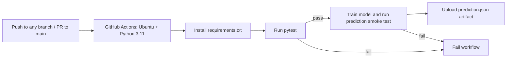

# Movie Rating MLOps: CI/CD on GitHub Actions

A reproducible Python machine-learning application that predicts movie ratings on a **0–10 scale** from the supplied dataset. The project includes data validation, missing-value preprocessing, a scikit-learn regression pipeline, automated tests, and a GitHub Actions workflow that trains and smoke-tests a prediction on every push.

## Repository contents

```text
.github/workflows/movie-rating-ci.yml  GitHub Actions pipeline
app/movie_rating.py                    Data handling, model, and inference logic
app/predict.py                         Train-and-predict CLI
data/Section14_Q4_Movie_Rating_CICD.csv Dataset tracked with the project
requirements.txt                       Reproducible Python dependencies
tests/test_movie_rating.py             Application and prediction tests
```

## Dataset and model

The checked-in CSV contains **480 movie records**. The target is `Rating_10`. Predictors are genre, runtime, budget (crore INR), popularity index, release year, release platform, and review count. `Movie_ID` is deliberately excluded because it is an identifier, not a meaningful predictive feature. The dataset has missing predictor values; numeric medians and most-frequent categorical values are imputed inside the training pipeline. The deterministic 80/20 split and random forest use fixed random seeds. Holdout MAE and R² are included in the prediction output.

The data appears to be supplied for this exercise and is used as-is; the repository does not assert that it represents a production or independently verified source. Predictions are illustrative, not guarantees of movie performance.

## CI/CD workflow



On a successful run, Actions keeps the JSON prediction and holdout metrics as the `movie-rating-prediction` artifact for 14 days. This repository currently implements automated CI and a model-prediction release artifact; a production service deployment is intentionally not configured because no hosting environment or deployment credentials were specified.

## Run locally

Python 3.11 is recommended.

```bash
python -m venv .venv
source .venv/bin/activate                 # Windows: .venv\\Scripts\\activate
python -m pip install --upgrade pip
python -m pip install -r requirements.txt
python -m pytest -q
python -m app.predict --output artifacts/prediction.json
```

Customize a prediction with, for example:

```bash
python -m app.predict \
  --genre Action --duration 130 --budget 75 --popularity 82 \
  --year 2025 --platform Both --reviews 18000
```

The command prints a JSON object with the estimated rating and holdout metrics. The optional `--output` path also saves the result as JSON.

## Important GitHub commands

```bash
# Inspect the repository and workflow status
git status --short --branch
gh run list --workflow movie-rating-ci.yml

# Inspect a run (replace RUN_ID with the ID from the list)
gh run view RUN_ID --log

# Retrieve the generated prediction artifact
gh run download RUN_ID --name movie-rating-prediction
```

## Recorded execution

The workflow runs on every push and on pull requests targeting `main`.

**Verified GitHub Actions run:** [Movie rating CI/CD #42169975112](https://github.com/mahidhar-lab/mlops-internal/actions/runs/42169975112) — triggered by push on 2026-11-06, commit `4ade2a91ec2b17e46c0d96bb0ad71a42877ef467`, conclusion **success**. This run used the refreshed Node 24-compatible GitHub Actions releases. The Actions job reports successful dependency installation, application-test step, prediction smoke test, and prediction-artifact upload.

**Reproducible local execution:** `python -m pytest -q` → **2 passed**. The prediction CLI completed on all 480 data rows; holdout comprised 384 train / 96 test rows; MAE **0.5606**, R² **0.6752**. For the sample Drama input (145 min, INR 50 crore budget, popularity 70, 2025, Streaming, 10,000 reviews), estimated rating was **6.42 / 10**. These metrics are the local execution output; the Actions run verified that its own smoke-test and artifact-upload steps passed.
